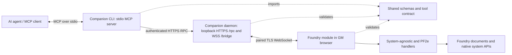

# Architecture

Foundry runs the module inside the GM's browser. A local companion runs beside the GM browser and MCP client; the Foundry host does not need a new inbound port. The browser makes an outgoing secure WebSocket connection to the companion's loopback listener.

## Request path

1. The MCP client launches `packages/companion/src/cli.ts`'s built CLI with the `mcp` command. The CLI exposes MCP over standard input/output and forwards tool calls to the local daemon over authenticated HTTPS.
2. `packages/companion/src/daemon.ts` binds to loopback, validates host, origin and bearer token, checks requests through the shared `parseTool` schema, bounds pending work, and routes the request over its paired GM browser WebSocket. It does not execute Foundry document APIs itself.
3. `packages/module/src/main.ts` receives requests in the browser, checks the current GM/world/socket session, validates arguments again, and either queues a write for GM approval or applies current-session automatic-write authorization.
4. Module dispatch constructs `BridgeContext` or `PF2eContext` and calls a bounded handler. Handlers validate target ownership, supported document/item type, membership and current state, then call Foundry or PF2e native APIs.
5. The module returns a structured success or error to the companion, which returns the MCP result to the client.

An error or timeout after a native write begins can leave the outcome uncertain. Results may include partial identifiers and `outcomeUnknown`; inspect Foundry before any retry. The daemon and module do not automatically replay writes.

## Package map

| Area                                            | Source                                                                                                                                                                                                                                                                                                                                                          | Responsibility                                                                                                                                                                                                                    |
| ----------------------------------------------- | --------------------------------------------------------------------------------------------------------------------------------------------------------------------------------------------------------------------------------------------------------------------------------------------------------------------------------------------------------------- | --------------------------------------------------------------------------------------------------------------------------------------------------------------------------------------------------------------------------------- |
| Shared contract                                 | [`packages/shared/src/index.ts`](../packages/shared/src/index.ts)                                                                                                                                                                                                                                                                                               | Zod schemas, `ToolName`, tool names, write/destructive classifications, common request/result types, MCP error helper and argument parsing. This is the cross-process contract.                                                   |
| Companion CLI                                   | [`packages/companion/src/cli.ts`](../packages/companion/src/cli.ts)                                                                                                                                                                                                                                                                                             | MCP stdio server, tool descriptions, configuration commands, HTTPS RPC client and status reporting.                                                                                                                               |
| Companion daemon                                | [`packages/companion/src/daemon.ts`](../packages/companion/src/daemon.ts), [`config.ts`](../packages/companion/src/config.ts), [`assets.ts`](../packages/companion/src/assets.ts)                                                                                                                                                                               | Loopback HTTPS/WSS, browser pairing, RPC validation/forwarding, TLS configuration and companion-side asset preparation.                                                                                                           |
| Module dispatch and UI                          | [`packages/module/src/main.ts`](../packages/module/src/main.ts), [`security.ts`](../packages/module/src/security.ts), [`bridge-context.ts`](../packages/module/src/bridge-context.ts), [`assets.ts`](../packages/module/src/assets.ts)                                                                                                                          | Foundry settings/UI, browser session, approval queue, request dispatch, general document operations, sanitization and shared context. `main.ts` also exports a test seam used by integration tests; preserve it during refactors. |
| System-agnostic encounter and snapshot handlers | [`encounters.ts`](../packages/module/src/encounters.ts), [`session-snapshot.ts`](../packages/module/src/session-snapshot.ts)                                                                                                                                                                                                                                    | Bounded encounter preparation/execution and factual selected-world snapshots, without PF2e assumptions for core operations.                                                                                                       |
| PF2e read/write adapter                         | [`pf2e.ts`](../packages/module/src/pf2e.ts), [`pf2e-target.ts`](../packages/module/src/pf2e-target.ts), [`pf2e-writes.ts`](../packages/module/src/pf2e-writes.ts), [`pf2e-conditions.ts`](../packages/module/src/pf2e-conditions.ts), [`pf2e-inventory.ts`](../packages/module/src/pf2e-inventory.ts)                                                           | System-gated PF2e compendium, party, import/staging, condition/effect and native inventory operations. `pf2e-target.ts` resolves supported world Actors and scene-token Actor context.                                            |
| PF2e live-play handlers                         | [`pf2e-checks.ts`](../packages/module/src/pf2e-checks.ts), [`pf2e-combat-context.ts`](../packages/module/src/pf2e-combat-context.ts), [`pf2e-strikes.ts`](../packages/module/src/pf2e-strikes.ts), [`pf2e-damage-context.ts`](../packages/module/src/pf2e-damage-context.ts), [`pf2e-damage-application.ts`](../packages/module/src/pf2e-damage-application.ts) | Native checks, context inspection, bounded strike/damage rolls, damage review and guarded application.                                                                                                                            |
| PF2e spellcasting | [`pf2e-spellcasting.ts`](../packages/module/src/pf2e-spellcasting.ts), [`pf2e-spell-cast.ts`](../packages/module/src/pf2e-spell-cast.ts), [`pf2e-spell-ledger.ts`](../packages/module/src/pf2e-spell-ledger.ts) | Bounded native spell/resource reads, expiring reviewed cast intents, guarded consumption/card creation, and a separate durable outcome ledger. See [native API evidence](v0.9-native-spellcasting-design.md) before changing resource or rank handling. |

Tests live in `packages/module/tests`, `packages/companion/test` and root `tests`. Build configuration creates output under package `dist/` directories. Release scripts create module and Windows setup archives under root `dist/`.

## Tool contracts and dispatch

Tool arguments are defined once in `packages/shared/src/index.ts`, alongside the `writeTools` and `destructiveTools` sets. The CLI turns those schemas into MCP tool definitions and adds user-facing descriptions. The daemon parses calls before forwarding them. The module parses them again before dispatch. A tool change should update and test all those layers together.

`writeTools` determines whether a request needs GM approval by default; `destructiveTools` supplies MCP metadata. These sets are not interchangeable. Reads, mutations, rolls and destructive operations must be classified according to their actual side effects. `assertWrite()` checks current authorization again inside handler context near native write calls.

The general Foundry handlers remain system agnostic and rely on Foundry documents. PF2e behavior belongs in the PF2e adapter, which checks the active system and uses native PF2e APIs. Do not infer system rules in generic handlers.

## State and serialization boundaries

- The module's browser runtime owns one connected GM socket, pinned world/user identity, per-connection approval queue and session-only automatic-write flag. Disconnecting or changing worlds invalidates that session and resets automatic writes.
- The companion daemon tracks one paired browser, in-flight/pending calls and request IDs in its own process. This is transport state, not a durable or distributed job queue.
- Encounter locks in `encounters.ts` serialize mutations within that loaded module process. The lock is not shared across browsers, worlds, daemon processes or servers.
- Damage review/application uses a recomputed review fingerprint and a GM-restricted world-setting ledger to detect/guard duplicate module-mediated applications. This persistent ledger is distinct from an in-memory lock; an uncertain reservation requires manual reconciliation. A review token is not a transaction or guarantee that Foundry will apply exactly the inspected amount after native hooks.
- Spell preview intents are bounded, expiring browser memory bound to world/user/current pairing. The bridge context exposes the current paired session through a getter and checks its captured session before mutations. Actor/entry/spell source hashes stay distinct from small stored selection/resource facts.
- Spell writes acquire the world-level spell-ledger lock, then the existing combat lock when applicable. Reservation persistence is verified before native consumption. The separate `spellCasts` world setting retains reserved/confirmed/uncertain outcomes; it never clears the damage ledger. Failed terminal persistence is observed and reported without rollback, refund or a second corrective write. Neither local lock controls manual writes or independent bridge processes.
- Foundry documents and native system APIs are authoritative for validation, permissions, rule effects and final document state.

The Windows setup bundle includes this architecture map and selected maintainer guides with the application files. It is not a full source checkout: test trees and historical campaign reports are excluded, so links to tests and historical/retest evidence require the repository.
