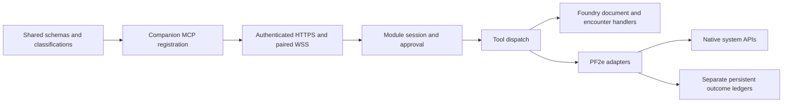

# Maintainability review — 2026-11-16

## Conclusion and scope

The project has useful package boundaries, a single input contract, and substantial failure-path tests. The best next investment is to reduce discovery work and separate responsibilities at existing boundaries. A rewrite, generic workflow framework, or repository-wide cleanup would add risk without established benefit.

This is a repository-wide maintainability audit with structural coverage and focused behavioral tracing, not an exhaustive correctness/security certification or line-by-line verification of every branch. Findings below distinguish observed maintenance problems from optional improvements. No production behavior, public API, persisted schema, dependencies, or live world was changed.

Reviewed checkout: `5bcaa757ba288f626c47c167a66e0326c56f666b`, version 0.13.0; initial working tree clean. [Coverage inventory](maintainability-inventory-2026-11-16.md) lists every tracked file and the depth of review. Historical reports were treated as evidence archives, not revalidated externally. No online release state was checked.

Production TypeScript totals 18,243 lines: shared 677, companion 1,395, module 16,171. Tests total 17,456 lines across the three test roots; seven scripts total 2,864 lines. These are physical lines, not complexity or token measurements.

## Architecture and change paths

Today bridge state, dispatch, general document handlers, and UI reside together in `packages/module/src/main.ts`. Domain handlers generally accept the small `BridgeContext` interface; PF2e context is an alias augmented with runtime checks by the bridge. This existing boundary is worth preserving.

| Change | Start with | Follow through | Verification |
| --- | --- | --- | --- |
| Add a tool | Shared schema and classification | CLI description → module dispatch → appropriate handler → tool reference and acceptance checklist | Shared contract, stdio discovery, handler and approval integration tests |
| Change a PF2e spell cast | Cast selection/resource resolution | Native API shape → source fingerprint → intent → ledger reservation → consumption/chat → terminal outcome | Cast, ledger, session/approval tests; matching-build live checks separately |
| Fix transport | Daemon pairing/RPC lifecycle | CLI timeout/error mapping → module receive/session/approval → disconnect behavior | Daemon, stdio, pairing and status tests |
| Change packaging | Windows source collector or module archive | Release input validation → manifest/checksums → ZIP verifier → CI | Archive, release, publication and Windows PowerShell tests |

### Agent context baseline

The inventory appendix records exact file sets for four representative tasks. Whole-file reading would expose 4,802 lines for tool addition (7 files), 6,894 for casting (7), 4,603 for transport (6), and 2,182 for Windows packaging (6). These are illustrative reading sets, not minimum required context, dependency closures, actual agent runs, or measured token usage. Tasks may require additional handlers and tests.

Future comparisons should use the same task and file selection, then record files/ranges actually read, input tokens if available, elapsed discovery time, and correctness of the resulting change. Smaller files alone are not success: fewer unrelated responsibilities and fewer cross-file assumptions are.

## Findings

Priorities below rank maintenance benefit, not vulnerability severity. P1 means address early; P2 means targeted follow-up; P3 is optional. Effort is relative (small: focused documentation/helper change; medium: reviewed extraction; large: several sequential changes).

### M1 · P1 · Current guidance contradicts implemented capabilities

**Evidence:** `docs/security.md:9` says tools do not cast spells, while `packages/shared/src/index.ts:64` defines spell tools and `packages/companion/src/cli.ts:110` describes casting. `CONTRIBUTING.md:97` labels v0.8.1 evidence as the current validation record. `docs/maintenance.md:57` similarly leads with old release evidence while `docs/validation-v0.13.0.md` distinguishes current source checks from pending live acceptance. Architecture's package map stops at early spellcasting rather than mapping resolution/effects/reconciliation.

**Cost:** agents must reconcile conflicting descriptions before changing code, and may infer incorrect scope or validation status.

**Recommendation:** correct current capability descriptions; replace duplicated current-status prose with a link to the versioned validation record; extend the architecture map to current subsystems. Keep dated reports intact. Keep canonical safety rules in AGENTS and link to explanations rather than repeating them everywhere.

**Benefit / effort / risk:** high / small / low. Accept when current guides agree with all 66 tool names and current capabilities, explicitly retain pending live acceptance, and no historical claims have been rewritten. Manual link and capability checks suffice; no new document snapshot tests.

### M2 · P1 · `main.ts` couples unrelated change contexts

**Evidence:** `packages/module/src/main.ts:45` defines shared runtime state, `:190` and `:313` sanitize document inputs, `:451` starts dispatch, `:693` begins general content handling, `:1162` handles document creation, `:1500` handles requests, and `:1684` defines the UI. The file is 2,141 lines. Integration tests import its `__test` seam (`:2122`) after constructing Foundry globals, e.g. `packages/module/tests/v08-integration.test.ts:28`.

**Cost:** a general document change exposes transport/UI concerns; tests and extraction attempts must account for import-time globals and shared state.

**Recommendation:** first extract general document sanitization and handlers behind explicit context dependencies. Leave approval, live session checks, runtime, and response wrapping in the bridge. Preserve the existing test seam through forwarding exports. Consider UI/session extraction only after this smaller boundary is proven.

**Benefit / effort / risk:** high / medium / medium. Verify existing operations, journal sanitization, preparation, assets, security and integration suites; preserve input rejection, partial outcomes, `assertWrite()` placement and UI behavior. New characterization tests should cover uncovered boundary behavior, not duplicate existing assertions.

### M3 · P1 · Source packaging constrains future modularization

**Evidence:** `scripts/package-windows.mjs:61` enumerates only top-level `.ts` children of the three source roots. `tests/windows-package.test.mjs:40` verifies selected required paths and exclusions, but does not create a nested production source fixture.

**Cost:** moving code into a subdirectory can pass normal build/typecheck yet silently omit required source from the Windows installation bundle, whose setup rebuilds the application.

**Recommendation:** before introducing nested sources, make collection recursive only within the three approved source roots. Retain the fixed non-source allowlist and existing privacy exclusions. Reject symlinks rather than following them; do not recurse across the repository.

**Benefit / effort / risk:** high as a prerequisite / small / medium. Add nested `.ts`, unrelated extension, generated/private path, and symlink fixtures; assert deterministic paths and no duplicate entries. Run archive/release tests and verify the reconstructed bundle builds. This is a future-refactor hazard, not evidence that current top-level sources are missing.

### M4 · P2 · Shared spell mechanics are repeatedly reimplemented

**Evidence:** `pf2e-spell-cast.ts:73–139`, `pf2e-spell-resolution.ts:80–140`, and `pf2e-spell-audit.ts:41–72` independently implement collection membership, canonical serialization, SHA-256 conversion, and secure nonce creation. Error wording and cloning fallbacks differ. `pf2e-spellcasting.ts:18` gives `.contents` precedence over arrays, unlike cast/resolution helpers.

**Cost:** future changes require comparing nearly identical helpers, and a broad deduplication could accidentally change semantics.

**Recommendation:** extract canonical serialization and digest-byte encoding first, with exact output equivalence. Keep domain-specific errors and source selection at callers. Treat membership, cloning, intent lifecycle, and ledger persistence as separate proposals requiring semantic comparison. Do not merge casts, resolutions, effects, reconciliation, and damage into one generic transaction engine.

**Benefit / effort / risk:** medium / small per helper / medium. Cover object-key ordering, arrays, null, nested values, and existing supported edge cases with fixed output vectors; verify unchanged review tokens using fixed inputs. Preserve existing unsupported-input behavior rather than silently introducing a new canonicalization policy.

### M5 · P2 · Internal dynamic data shapes weaken local reasoning

**Evidence:** `packages/module/src/bridge-context.ts:3` exposes `game`, resolution and serialization as `any`; `pf2e-spell-cast.ts:463` and `pf2e-spell-resolution.ts:334` resolve substantial native state, while many internal references remain dynamic. Strict TypeScript is enabled, but `any` bypasses those checks. Ledgers already demonstrate useful explicit record types.

**Cost:** a maintainer must read constructors, consumers and fixtures to discover which fields or method results are relied on.

**Recommendation:** type module-owned selection, resolved facts, UI history rows, and outcome objects incrementally. Introduce minimal native interfaces only where the installed API shape is established. Retain runtime guards and explicit compatibility paths; do not replace `any` with unchecked casts or import a broad speculative Foundry type model.

**Benefit / effort / risk:** medium / medium per workflow / medium. Begin with cast internal result shapes and compile their existing fixtures against them; run cast/ledger/spellcasting tests plus typecheck. This is a maintainability issue, not proof of runtime failure.

### M6 · P2 · Test setup repeats expensive environment knowledge

**Evidence:** version-named integration suites such as `v07-integration.test.ts:28` and `v08-integration.test.ts:28` each bootstrap Foundry globals and bridge runtime; spell suites separately construct scenes, tokens, actors and native APIs (`pf2e-spell-cast.test.ts:230`, `pf2e-spell-resolution.test.ts:28`, `pf2e-spell-effect.test.ts:7`).

**Cost:** test selection requires release-history knowledge, and common environment changes require repeated setup edits.

**Recommendation:** add a small navigation table from behavior to tests; pilot a shared bridge bootstrap in the v07/v08 suites. Keep native spell fixtures scenario-specific until equivalence is demonstrated. Use explicit builders, not a fixture framework with many boolean switches. Do not bulk rename tests before updating CI/docs and verifying discovery.

**Benefit / effort / risk:** medium / medium / medium. Preserve assertions and discovery counts, and prove each migrated suite runs alone and together without leaked runtime, timers, mocks or intent state. Existing tests cover real stale/hash/lock/native-failure boundaries and should be retained.

### M7 · P2 · Tool descriptions have no compile-time completeness requirement

**Evidence:** `packages/companion/src/cli.ts:87` accepts an arbitrary string; its descriptions are `Record<string, string>`, and `:206` falls back to a generic description. The shared contract derives `ToolName`, but a new tool can omit a deliberate description without a type error. `tests/shared.test.ts` checks an explicit 66-tool list, and CLI discovery derives registration from shared schemas.

**Cost:** a tool addition requires manual synchronization; a generic fallback can conceal missing side-effect guidance.

**Recommendation:** isolate the description map into a small module keyed with `satisfies Record<ToolName, string>`, accepting `ToolName` at lookup. Preserve shared schemas/classification as the authority, and keep deliberate classification tests. Do not introduce a second tool registry or change wire schemas during this extraction.

**Benefit / effort / risk:** medium / small / low. Typecheck must reject a missing or misspelled key; stdio tests must still discover 66 tools with unchanged annotations and descriptions. Structural completeness cannot prove that prose accurately describes side effects; retain human review.

### M8 · P3 · Dense formatting makes safety-heavy code harder to scan

**Evidence:** compound guards, nested conditionals and long object literals in `pf2e-spell-effect-ledger.ts:107–147`, audit helpers at `pf2e-spell-audit.ts:41–72`, and embedded UI strings in `main.ts:1728` compress important distinctions into long lines.

**Cost:** readers spend additional effort locating branches and reviewing diffs in already demanding validation code.

**Recommendation:** format only touched files and extract named predicates when they communicate a domain rule. Preserve validation order and exact accepted inputs. Avoid blanket formatting or rewriting every guard as an abstraction.

**Benefit / effort / risk:** modest / small / low for formatting, medium for logic extraction. Run affected ledger/audit tests for predicate changes; formatting alone needs diff inspection and typecheck, not new tests.

## Sequential implementation roadmap

The initial roadmap was implemented sequentially. Tasks 2–7 are complete; Task 8 reassesses the remaining maintenance work below. The task descriptions and original acceptance criteria are retained as the audit record.

| Order | Task and scope | Prerequisites | Acceptance and checks |
| --- | --- | --- | --- |
| 1 | Repair current guidance and add a compact behavior → owner → test table to the existing maintenance guide (M1/M6) | None | Link current validation once; map all subsystems; retain historical docs; manually check links and capabilities |
| 2 | Make description completeness explicit in a top-level companion module (M7) | None | No string/schema/annotation changes; typecheck; shared and stdio tests |
| 3 | Harden Windows nested source collection (M3) | Before any nested directories | Focused archive fixtures; release/publication tests; standard and Windows package builds; verify packaged source build |
| 4 | Extract general document validation/handlers from `main.ts` (M2) | 1 and 3 | Explicit context; preserved `__test` bridge seam; existing general/integration suites; full tests/typecheck/build and packaging |
| 5 | Extract canonicalization and digest encoding only (M4) | 1; 3 if nested path used | Fixed equivalence vectors; cast/resolution/audit/effect regressions; no token or ledger format changes |
| 6 | Type cast-owned intermediate/results data (M5) | 5 reviewed first | Existing native guards remain; typed fixtures; cast/ledger/spellcasting tests and typecheck |
| 7 | Pilot common bridge test bootstrap in two suites (M6) | 4 | Both suites isolated/together and full suite; no assertion reduction or state leakage |
| 8 | Reassess remaining hotspots using the same representative tasks | 1–7 | Compare actual reading ranges/context costs; authorize further UI/selection extraction only with demonstrated benefit |

Apply M8 opportunistically inside these tasks. Defer general ledger unification, wholesale `any` removal, test framework rewrites, schema splitting, and module-wide error normalization. The evidence does not establish that their benefits exceed their costs.

## Task 8 reassessment

The first six tasks produced specific, limited reductions in representative context volume and exposed the remaining costs. The measurements below compare current whole-file sets with the audit's pre-change sets in [the coverage inventory](maintainability-inventory-2026-11-16.md). They are line-count proxies, not measured agent tokens or a guarantee that each file must be read in full.

| Representative change | Before | After | Change and implication |
| --- | ---: | ---: | --- |
| Add a tool | 4,802 lines | 3,972 lines | 830 fewer, mainly because `main.ts` is smaller; the shared contract, CLI and docs still need coordinated edits. |
| Change spell casting | 6,894 lines | 6,106 lines | 788 fewer across the same seven-file set; cast resource, native API and ledger behavior remain coupled and need those owners/tests together. |
| Fix transport | 4,603 lines | 3,773 lines | 830 fewer because `main.ts` is smaller; transport still spans companion, shared contract and bridge session handling. |
| Change Windows bundle | 2,182 lines | 2,246 lines | 64 more because the focused archive tests grew; nested source coverage is now explicit and limited to approved source roots. |

The document-operation extraction reduced `main.ts` from 2,141 to 1,305 lines and placed those operations in `general-documents.ts` (840 lines). It is now an independent starting point for general document behavior; the dispatch, approval queue, transport session and UI still share `main.ts`. The next extraction candidate is a focused bridge UI/session split, but it needs a separate design and tests for request-ID deduplication, approval expiry, response ordering, audit UI refresh, disconnect behavior, and the existing `__test` seam. Do not start it as another broad mechanical move.

The type and fingerprint tasks improved explicit cast outcomes and removed duplicated canonicalization logic without merging workflow ledgers. The two-suite bootstrap reuse worked in isolation and in the full suite; it is sufficient as a pilot. Broader fixture consolidation is not yet justified by evidence.

**Next recommended step:** use the remaining hotspots as a menu, not an automatic queue. When a real feature needs bridge UI/session code, plan one narrow extraction around that behavior and compare actual files/ranges read before and after. Defer additional refactoring until that comparison demonstrates less unrelated context without hiding safety checks or increasing cross-file navigation.

## Validation and handoff

Environment: Node v24.18.0, npm 11.16.0; installed dependencies used, no `npm ci` or dependency changes.

| Command | Actual result |
| --- | --- |
| `npm test` (sandbox) | 41 files passed, 4 failed; 414 tests passed, 18 failed, 13 skipped; 3 unhandled errors. Local socket and subprocess EPERM restrictions prevent treating this as a code regression baseline. |
| `npm test` (approved execution with socket/subprocess access) | 45 files passed; 444 tests passed, 1 skipped, 445 total; exit 0. |
| `npm run typecheck` | Passed; exit 0. |
| `npm run build` | Passed for shared/module/companion; exit 0. Rollup removed two dependency PURE annotations it could not interpret. |

The skipped test is the optional PowerShell smoke test in `tests/windows-powershell.test.mjs:105`; this environment did not supply an available PowerShell runtime. CI declares a separate non-skippable Windows PowerShell 5.1 job; this review did not execute or verify remote CI. No current Windows-native acceptance is claimed.

Changed files: this report and its inventory only. Build/test outputs are generated and untracked/ignored. No code regression tests were added because this is an audit, not a behavior change. Final documentation checks and working-tree inspection are recorded in the handoff message.

Not performed: archive generation commands (`npm run package`, `npm run package:windows`), dependency vulnerability audit, external API/source verification, release publication checks against GitHub, deployment, or live Foundry acceptance. Fixture-based release/archive tests ran as part of the suite. Live compatibility remains pending matching-build deployment/version verification and isolated workflow checks; no live-world writes occurred.
